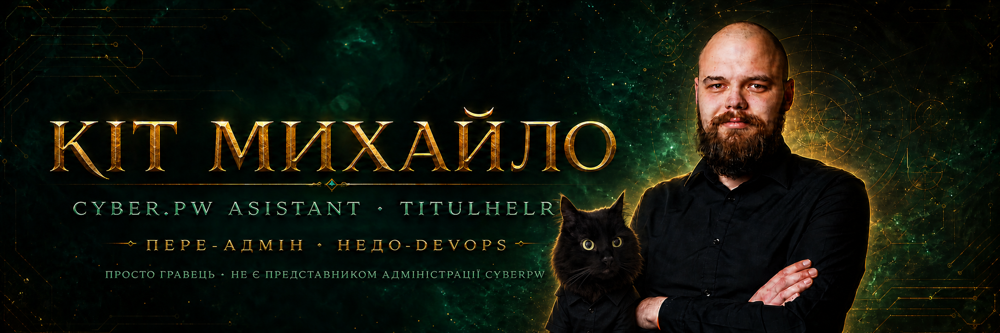

  

<h1 align="center">Віталій Головня · Кіт Михайло 🐈‍⬛</h1>

  <strong>IT Support · System Administration · Infrastructure · Automation</strong> 
  Практичні IT-рішення, автоматизація, вебпроєкти та інструменти для спільнот

  
  
  

---

## 🚀 CyberPW Assistant — проєкт Кота Михайла

Неофіційний набір інструментів для Perfect World / CyberPW: Windows-утиліта, довідники, автоматизація та документація. Основний вихідний код приватний, готові збірки доступні окремо.

  
  

  
  
  

**Модулі та можливості:** TitulHelper (пошук і прогрес титулів, координати), MultiLauncher, Macro Studio (beta), вікторини, симулятори, довідники, календар подій, оновлення через GitHub Releases з перевіркою SHA-256. Доступність окремих функцій залежить від версії збірки.

**Корисні посилання:** [Сайт CyberPW](https://cyberpw.fun/) · [Обговорення на форумі](https://forum.cyberpw.fun/index.php?threads/titulhelper-1-0.271/) · [Кабінет](https://cabinet.cyberpw.fun/) · [Реєстрація з бонусом](https://cabinet.cyberpw.fun/register.php?ref=4550) · [YouTube](https://www.youtube.com/@Vitalik_Juk)

> [!IMPORTANT]
> CyberPW Assistant — неофіційний фанатський проєкт. Деякі модулі перебувають у Beta. Перед використанням автоматизацій перевіряйте правила сервера. Я не є представником адміністрації CyberPW.

---

## 👨‍💻 Про мене та навички

Мій напрям — **технічна підтримка, системне адміністрування, діагностика та автоматизація**. Працюю з технічними проблемами, документую рішення та розвиваю власні інструменти й сайти. Для розробки також використовую AI-асистентів; комерційний досвід не прирівнюю до всього стеку особистих проєктів.

| Напрям | Практика та інструменти |
|---|---|
| **IT Support / IT Operations** | Підтримка користувачів, обробка заявок, пошук причин збоїв, документація |
| **Windows & macOS** | Налаштування Windows; діагностика macOS, CrossOver / Wine, сумісність та локалізація |
| **Мережі та моніторинг** | Базова TCP/IP-діагностика, мережеві проблеми, Zabbix |
| **Автоматизація** | PowerShell / Bash на рівні практичних сценаріїв, AI-assisted workflows |
| **Git та релізи** | GitHub, гілки, збірки, релізи, оновлення, GitHub Actions та Pages |
| **Вебпроєкти** | HTML, CSS, JavaScript, Node.js, інтеграції Supabase / Edge Functions у власних проєктах |
| **Документація** | Інструкції, troubleshooting-гайди, відтворювані кроки вирішення проблем |

**Цікавлять ролі:** IT Support L2/L3 · System Administrator · Infrastructure / IT Operations · Automation-oriented Support.

**Мови:** українська — вільно; англійська — A2.

---

## 🌐 Мої сайти та вебпроєкти

| Сайт / проєкт | Що це |
|---|---|
| 📚 **[Титули CyberPW — сайт](https://vitalikjukivskiy.github.io/titulPW/)** · [код](https://github.com/vitalikjukivskiy/titulPW) | Довідник ігрових завдань, NPC та координат на GitHub Pages |
| 🏰 **[СІЧ: доба шаблі](https://github.com/vitalikjukivskiy/sich-rpg)** | Українська браузерна RPG; Node.js, тести, Supabase Edge Functions, GitHub Pages |
| 🌘 **[ЛІМБ — Хата пам'ятає тебе](https://github.com/vitalikjukivskiy/limb-site)** | Сайт майбутньої гри з інтерактивним прологом, адаптивним інтерфейсом і автоматичною публікацією |
| 🍎 **[CyberPW на Mac — технічний гайд](https://github.com/vitalikjukivskiy/cyberpw-mac-crossover-guide)** | Налаштування CrossOver на Apple Silicon, запуск, локаль, виправлення помилок |

## 🧰 Інструменти, збірки та документація

| Репозиторій | Призначення |
|---|---|
| **[CyberPW Assistant Releases](https://github.com/vitalikjukivskiy/cyberpw-assistant-releases)** | Розповсюдження Windows-збірок та історія релізів |
| **[CyberPW Assistant 2.0](https://github.com/vitalikjukivskiy/titul_helper-2.0)** | Публічний репозиторій, пов'язаний із наступною версією хелпера |
| **[CyberPW / TitulPW](https://github.com/vitalikjukivskiy/titulPW)** | Вебдовідник і сторінки проєкту |
| **[Усі публічні репозиторії](https://github.com/vitalikjukivskiy?tab=repositories)** | Інші експерименти, сайти та інструменти |

## 🔧 Підхід до роботи

**Знайти проблему → відтворити → усунути → задокументувати → перевірити.**

Мене цікавлять практичні рішення, які спрощують підтримку та зменшують кількість повторюваних ручних дій.

---

  <a href="https://github.com/vitalikjukivskiy/cyberpw-assistant-releases/releases">⬇️ Завантаження CyberPW Assistant</a> ·
  <a href="https://www.youtube.com/@Vitalik_Juk">▶️ YouTube</a> ·
  <a href="https://send.monobank.ua/jar/93N5FBB3zX">☕ Підтримати проєкт</a>

  <strong>Пере-адмін · Недо-DevOps · Кіт Михайло 🐈‍⬛</strong>

